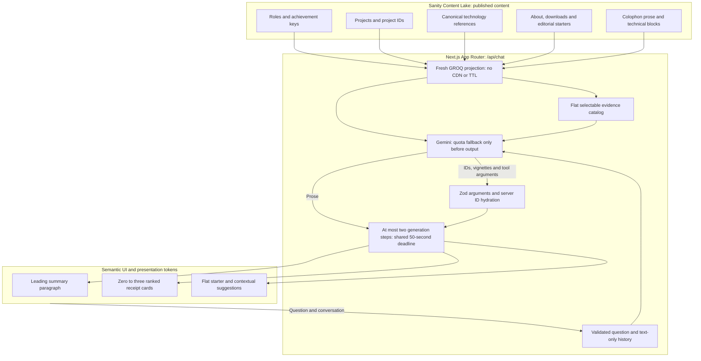
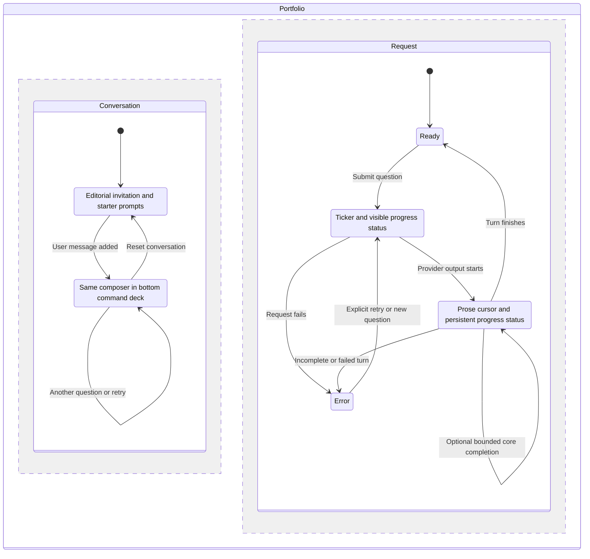

# How joestein.dev Was Built

*How a prompt-first, grounded AI engineering portfolio was architected, modeled, tested, and styled—and the delivery workflow behind it.*

## 1. Product Philosophy: Prompt-First, Dual-Mode & Beyond the Resume

A chronological resume is useful for scanning, but it often hides the implementation decisions behind an achievement. A conversational portfolio can expose that depth while introducing different risks: invented facts, first-person impersonation, and an interface that makes visitors work too hard to find evidence.

`joestein.dev` starts with a question and supports a traditional overview, while keeping its engineering evidence in a normalized Sanity content graph.

* **Prompt-first, with a traditional alternative:** Visitors land on Prompt Mode and can switch to Overview Mode or download a resume. Prompt Mode is the primary product; its answers are not constrained to mirror the overview’s selected bullets. Both modes use the same published content and semantic renderers.
* **A transparent third-person guide:** The assistant is instructed to speak about Joe as Joe, he, and him. It answers as an engineering peer rather than impersonating him. Those instructions guide generation; they are not a mathematical guarantee of factual prose.
* **A unified evidence pool:** Career achievements and independent projects—Luff.Photo, Archtypica’s storefront and Discogs companion, Freaky Frank’s EPK, and joestein.dev—are ranked together. The server preserves each receipt’s achievement/project type for future presentation choices. Long vignettes can expand inline, without a separate engineering-details accordion.
* **Integrity scaled to consequences:** This is a personal portfolio, not a mission-critical decision system. Deterministic code verifies selectable identities, resolves authoritative metadata, and filters unsafe link protocols. The model still synthesizes narrative and subjective relevance scores. Structural validation is not proof of narrative accuracy, and failures stay visible with a retry action.

## 2. Phase 1 & 1.5: Semantic Core, Sanity CMS & Direct Context Grounding

The first functional prototype deliberately used browser-default semantic HTML before custom typography and visual layout. Small disposable wireframe styles were introduced during iteration; the principle was to settle content, interaction, and reading order before designing a theme. Semantic elements and explicit `data-slot` contracts became the stable foundation for the later visual layer.

### Normalized Career & Project Graph

The portfolio uses four core document types: `technology`, `role`, `project`, and an `about` singleton. Achievements live inside roles, with stable `_key` identifiers, track tags, technology references, and `includeInDefaultOverview` flags. Projects reference the same technology catalog. About owns the introduction, story, contact details, resume assets, and editor-curated starter questions. A reusable `page` type now stores this colophon as Portable Text.

* **Resume ingestion through connected tools:** Dropbox MCP provided source resumes. Sanity MCP and the Sanity best-practices skill supported deduplication, canonical technology references, and content ingestion. Later editorial work added stories and projects beyond those resumes, so counts are intentionally not frozen in this article.
* **Direct context rather than vector search:** A GROQ projection fetches published portfolio data and injects a typed JSON representation into the system prompt. This keeps a portfolio-sized corpus understandable without an embeddings index. It is direct context grounding, not a separate vector-retrieval pipeline.
* **Fresh content and live answers:** Server reads use the published perspective, `useCdn: false`, and `cache: "no-store"`. React `cache()` deduplicates reads within a server render; it is not a cross-visitor 60-second TTL. Generated answers are neither canned nor cached. Provider and hosting costs still apply; the architecture does not imply a zero-cost service.

### Flat Evidence Catalog, ID-Pointer Hydration & Bounded Completion

Gemini sees a flat catalog of selectable achievement keys and project IDs. Role summaries supply background without exposing role IDs as selectable evidence. Ambiguous identifiers are excluded from the catalog.

* **ID-pointer server hydration:** The model proposes an exact catalog ID, a score from 1–100, an optional match reason, and a concise third-person engineering vignette, normally two or three sentences. Zod validates the argument shape and score range. Server lookup discards unknown identifiers, deduplicates selections, sorts by relevance, and hydrates company, role, dates, technology tags, and project URLs from Sanity. These metadata fields are not copied from model-generated arguments.
* **Three receipts are a ceiling, not a quota:** Achievements and projects share one relevance scale, with zero to three genuinely relevant cards. An empty array is valid when the published portfolio contains no matching evidence. Scores are the model’s assessment of relevance, not calibrated probabilities.
* **Bounded two-step completion:** A healthy response contains a concise summary and one core renderer—`showReceipts`, or an explicitly requested `showDownloads` or `showOverview`—in one generation step. Three contextual suggestions are requested alongside that output but remain nonfatal when missing. A clean prose-only or tool-only result permits one completion step to supply the missing core output. Both steps share a 50-second deadline. The application does not loop indefinitely or spend another step solely to obtain suggestions.
* **Safe quota fallback before output:** The default chain is `gemini-3.5-flash-lite`, `gemini-3.1-flash-lite`, `gemini-3.8-flash`, then `gemini-3.6-flash`. `GEMINI_MODEL` can replace the primary, and duplicates are removed. With zero SDK transport retries, pre-output 429/quota failures advance to the next model. Provider bookkeeping can be buffered, but once answer or tool chunks start, the turn cannot change models—even during a completion step. Non-quota errors retain normal failure handling, and only quota exhaustion across the chain produces the capacity-specific banner. Availability and independent quotas are not guaranteed.

A November 18, 2026 compatibility check with the local app credential confirmed streaming tool calls on 3.5 Flash Lite, 3.1 Flash Lite, and 3.8 Flash using low thinking effort. The 3.6 Flash check remained unverified after two temporary high-demand 503 responses. Listing a model is not proof that it can fulfill a request, and a local credential check does not verify deployment configuration.

### LLM Guardrails and Deterministic Validation of Model Outputs

Client-supplied tool outputs are not trusted as portfolio facts. The server validates incoming messages, forwards only text history, and loads fresh authoritative content before each answer. Conversation context helps with meaning; the interface does not promise citation-style references to earlier receipt numbers.

Invalid or incomplete core output is disclosed. Optional follow-up navigation can fail independently without spoiling a complete answer. A receipt remains useful without a match reason; in that case the UI keeps the score and vignette and omits the reasoning disclosure.

The implementation intentionally stops short of claim-by-claim verification, externally calibrated relevance scores, adversarial certification, or approval gates appropriate to a consequential workflow. For this portfolio, the goal is useful live exploration with clear evidence boundaries and recoverable failures. A mission-critical product would need stronger domain-specific evaluation, monitoring, and potentially human approval.

## 3. Phase 2.0: Prompt-First UX & White-Label Design Tokens

The visual layer was developed from a working HTML/CSS reference mock after the core interaction model had settled. Automated DOM, schema-boundary, geometry, and AI SDK stream tests protect behavior independently of the theme; builds, lint, TypeGen, and TypeScript checks complement those tests. Passing them is not a substitute for browser or accessibility review.

### Helping Visitors Ask Useful Questions

* **Prompt scaffolding:** The placeholder offers concrete starting points: “Ask about a problem like yours, gauge depth in a tech stack, or paste a job/project brief…” Editor-curated starters offer recognition-based entry points without constraining freeform questions.
* **Accessible length validation:** The textarea accepts pasted briefs without a hard `maxLength`. A tabular counter warns at 10,800 characters and identifies an exceeded limit above 12,000 with text and `aria-invalid`, disabling submission while preserving the full input. The server applies the same acceptance boundary.
* **Flat suggestions with explicit origin:** Clicking a starter immediately submits that exact question. If that turn returns three contextual questions, they replace only the clicked starter in a single flat list. They are first-class prompts, not children in a navigation tree. `data-tier` and `data-origin-id` preserve provenance for future themes. Missing suggestions leave the starter intact.
* **Visible equivalence to typing:** A clicked suggestion reveals in the existing textarea without delaying its request. Reduced-motion users see the full question immediately. Submitted text clears when the request finishes, while a draft edited during generation is preserved.

### Separate Conversation State from Request Status

The shell exposes `data-conversation-state="idle|active"` independently of `data-request-state`. It does not implement `pending` as a third conversation-layout state.

* **Idle:** An editorial invitation in Instrument Serif sits beside the starter questions on desktop and above them on smaller screens.
* **Active:** As soon as a user message is added, the same textarea moves into the bottom command deck without unmounting. Desktop uses a 50/50 composer/topic split. Mobile places a horizontal contextual strip and click-triggered `Topics +` expansion above the composer. Textarea type remains at least one rem on mobile.
* **Submitted and streaming:** A disabled submit button overlays a “Pulling receipts…” ticker on retained label geometry, so the loading label does not widen the button. A conversation-level status stays visible before prose, during receipt loading, and through bounded completion. A blinking cursor follows actual streamed prose. Reduced motion disables animation. There is no temporary Stop button changing the tray’s height.
* **Bounded page auto-follow:** Measured question, content, header, tray, and visual-viewport bounds help keep new content visible above the tray. Following stops at the question’s top boundary below the header. Wheel, touch, pointer, click, or keyboard interaction cancels motion and relinquishes that turn; a new question or explicit retry can rearm it. Reduced motion uses immediate positioning. Reading remains ordinary document scrolling, without an inner conversation scroll panel.

### Visual System & Accessibility Invariants

* **Dark bookends and archival paper:** Header and active tray use dark-cover semantic tokens around a warm paper canvas and subtle blueprint grid. Instrument Serif, Plus Jakarta Sans, and JetBrains Mono are assigned display, prose/UI, and technical roles through CSS custom properties. The primary ink/surface pair has high contrast; the design targets AAA primary text and AA secondary text. This is a design constraint, not a claim of whole-site WCAG certification.
* **Titleless quote receipts:** CSS multi-column layout and `break-inside: avoid` arrange varying card lengths without JavaScript masonry. Each card begins with a tailored narrative, followed by a piped technology list, authoritative footer metadata, and a radial relevance score. Stories over roughly 320 characters have an inline `more...`/`less` control, so not every long narrative is initially shown in full.
* **Click-only disclosures:** Base UI provides the relevance popover and mobile topic disclosure. The score’s `(i)` button appears only when a match reason exists, with hover activation disabled. Keyboard and touch users can open disclosures, and Escape/outside interaction can close them. Source order, labels, focus behavior, and status announcements belong to the functional core rather than the theme.

## 4. Agentic Engineering Workflow

The delivery process joined conversational product framing, a working reference mock, scoped implementation requests to OpenAI Codex, and iterative review of behavior and diffs. Sanity MCP and its best-practices skill supplied concrete content-modeling and ingestion capabilities; agents were implementation teammates rather than an excuse to accept generated code without architectural scrutiny.

* **An evolving repository constitution:** `AGENTS.md` captured package-manager rules, workspace boundaries, normalized content modeling, semantic HTML, accessibility, and design-token constraints. Some of these principles were explicit in requests; others were refined through prototype iterations and then recorded for future work. The file did not invent the product strategy by itself.
* **Structure and presentation are separate contracts:** Domain JSX exposes meaningful `data-slot`, conversation/request state, and prompt-origin attributes. Colors, typography, spacing, and layout live in semantic CSS token layers. The aim is theme portability and a foundation for white-label work; multiple finished commercial themes are not a claim of this implementation.
* **Rule conflicts become explicit trade-offs:** When a shortcut would compromise a documented value, the workflow calls for identifying the conflict, offering a compliant approach, and obtaining approval for a scoped exception. Human review remains part of the delivery loop.
* **Explicit contracts support handoffs:** A new implementation session can inspect repository instructions, types, tests, and the existing semantic structure. That reduces dependence on conversational memory. The evidence supports a repeatable handoff pattern, not a claim that independent agents converged without shared context.
* **The portfolio is also a product-engineering example:** Repeatedly testing real questions changed the requirements: hard receipt limits became acceptable once scores were inspectable; generated starter questions became editorial; hierarchical bubbles became flat prompts with lineage; completion and quota handling became bounded policies. Product judgment and engineering design developed together.
